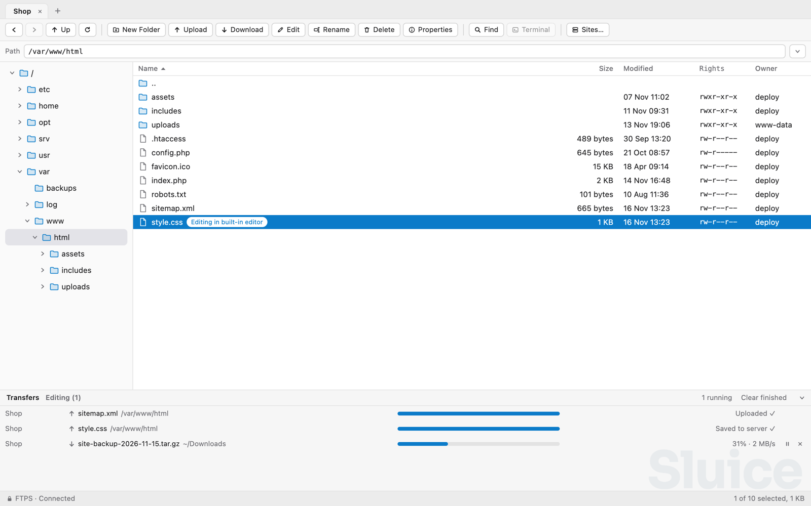

<h1 align="center">Sluice</h1>

A file manager for your servers.

Pick a saved site, double-click a file, edit it in the built-in editor or VS Code, and every save goes straight back to the server.

Sluice connects over SFTP, SCP, FTP and FTPS. WebDAV and S3 are to come.

<picture>
  <source media="(prefers-color-scheme: dark)" srcset="docs/images/main-window-dark.png">
  
</picture>

## Download

**[Download the latest version for Mac](https://github.com/getsluice/sluice-releases/releases/latest/download/Sluice.dmg)** (macOS, Apple Silicon and Intel)

Each version and its release notes are listed under [Releases](https://github.com/getsluice/sluice-releases/releases).

## Installing

1. Open `Sluice.dmg` and drag Sluice to the Applications folder.
2. The first time, open Sluice from Applications. If macOS says it can't check the app, open System Settings, go to Privacy & Security, and choose **Open Anyway** next to Sluice. Confirm with your password or Touch ID if macOS asks. You only need to do this once for each version.
3. If Sluice asks to use your Keychain for saved passwords, choose **Always Allow**.

## User guide

The [user guide](docs/README.md) explains how to use Sluice:

- [Getting started](docs/getting-started.md)
- [Sites](docs/sites.md)
- [Browsing](docs/browsing.md)
- [Editing files](docs/editing.md)
- [Transfers](docs/transfers.md)
- [Terminal and Find](docs/terminal-and-find.md)
- [Settings](docs/settings.md)
- [Security and privacy](docs/security-and-privacy.md)
- [Troubleshooting](docs/troubleshooting.md)

## Licence and legal

Sluice is free for personal and work use. The app is licensed under [LICENSE.md](LICENSE.md), which covers the app as it's distributed in this repository's releases.

- [TERMS.md](TERMS.md): the terms of use.
- [PRIVACY.md](PRIVACY.md): the privacy policy. The app sends no analytics, crash reports or usage data.
- [THIRD-PARTY-NOTICES.txt](THIRD-PARTY-NOTICES.txt): the open-source components Sluice includes, and their licences.

## About this repository

This repository holds Sluice's installers and release notes, its user guide, and its licence, terms and privacy policy. The source code is not public.

Found a problem? [Open an issue](https://github.com/getsluice/sluice-releases/issues). Say which version of Sluice and of your operating system you're using, and what you did just before it happened.
