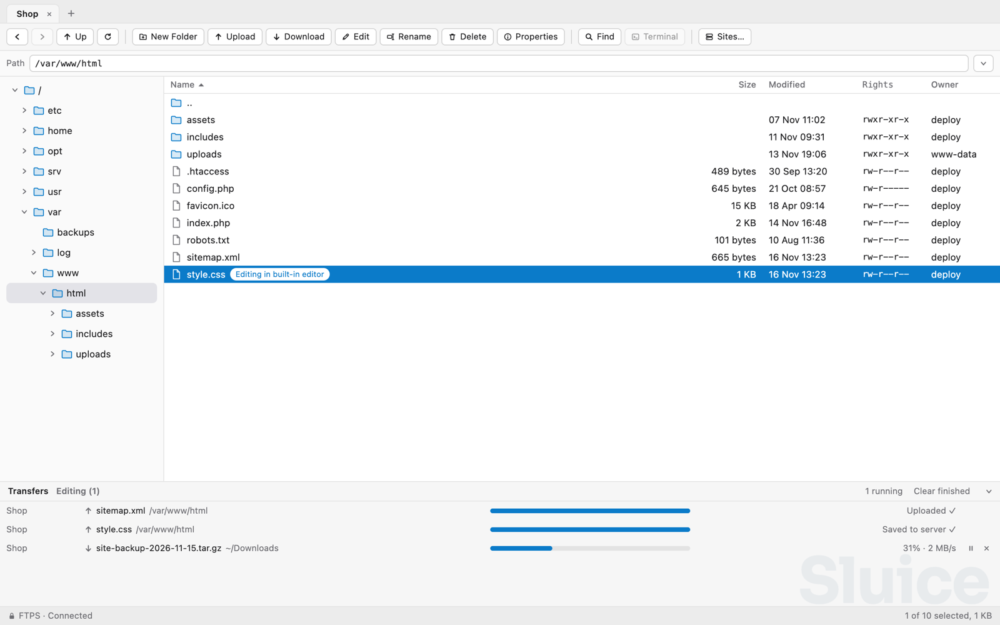

# Browsing

[User guide](README.md) › Browsing

## The window

From top to bottom, Sluice's window has:

- the **tab strip**, with a tab for each server you're connected to;
- the **toolbar**;
- the **path bar**, which shows the folder you're in;
- the **folder tree** on the left and the **file list** on the right;
- the **bottom panel**, with your transfers, the files you're editing, and any terminals or searches you've put there;
- the **status bar**.

The window's title says where you are, such as `user@host: /var/www`.

## Tabs

Each server you connect to has its own tab, named after the site. Hover over a tab to see its `user@host`.

- To open another server, show the **Sites** tab (choose **＋**, choose **Sites…** on the toolbar, or press ⌘T) and connect from there. The Sites tab turns into the server's tab.
- Tabs on the same site share one connection, so you only log in once.
- To close a tab, choose its **✕** or press ⌘W. If it's the last tab on a site whose files you're editing, Sluice asks whether to keep uploading their saves. See [Editing files](editing.md#closing-a-tab).
- To close the window, press ⇧⌘W.
- With the tab strip in focus, ← and → move between tabs, and Return or Space shows the one in focus.

A terminal or a search can have a tab of its own too. See [Terminal and Find](terminal-and-find.md).

## The toolbar

| Button | What it does |
| --- | --- |
| Back, Forward | Go back or forward through the folders you've visited in this tab. |
| Up | Go to the folder that holds this one. |
| Refresh | List the folder again. |
| New Folder | Make a folder here. |
| Upload | Choose files or folders on your computer to upload here. |
| Download | Download the selected items to your computer. |
| Edit | Open the selected files for editing. |
| Rename | Rename the selected item. |
| Delete | Delete the selected items. |
| Properties | Show the selected item's details and permissions. |
| Find | Find files by name in this folder and the folders inside it. |
| Terminal | Open a terminal in this folder, in the bottom panel. |
| Sites… | Show the Sites tab. |

A button is greyed out when it can't be used, such as Rename with more than one item selected. On FTP and WebDAV sites, Terminal is always greyed out. Hover over it to see why: "FTP has no terminal." or "WebDAV has no terminal."

## The path bar

The path bar, labelled **Path**, shows the folder you're in. To go somewhere else, click it, or press ⇧⌘G (Go › Go to Folder…), type a path and press Return. A path that doesn't start with `/` is taken from the folder you're in, so `../log` and `html` both work. Escape puts back the folder you're in.

The **▾** button beside it lists the last ten folders you've visited in this tab.

## The folder tree

The folder tree shows the server's folders. Click a folder to show it in the file list, and click its arrow to open or close it in the tree. With the tree in focus, ↑ and ↓ move between folders, → and ← open and close them, and Return shows the one in focus.

A folder you don't have permission to open has a lock beside it.

Drag the divider between the tree and the file list to make the tree wider or narrower. Sluice remembers the width.

## The file list

The file list shows what's in the folder, folders first. Its columns are **Name**, **Size**, **Modified**, **Rights** and **Owner**. A `..` row at the top goes up a folder when you double-click it.

On WebDAV sites, the **Rights** and **Owner** columns are empty, because WebDAV has no permissions or owners.

- Double-click a folder to open it.
- Double-click a file to edit it. See [Editing files](editing.md).
- A file you're editing is tagged with its editor, such as "Editing in VS Code".
- Items being deleted are dimmed until they're gone.

If the folder is empty, the list says "This folder is empty". If it holds only hidden files and they aren't showing, it says "This folder only has hidden files".

### Selecting

- Click an item to select it.
- ⌘-click adds an item to the selection, or takes it out.
- ⇧-click selects everything from the last item you clicked to this one.
- ↑ and ↓ move the selection, and Home and End go to the first and last item. Hold ⇧ to select a range.
- With the list in focus, ⌘A (Edit › Select All) selects everything in it.

### Sorting

Click a column's heading to sort by it. Click it again to reverse the order. Folders always come before files.

### The right-click menu

Right-click an item, or the empty space in the list, for:

- **Edit**, **Open with built-in editor** and **Open with…**, for files;
- **Open**, for a single folder;
- **Upload…** and **Download…**;
- **Rename**, **Delete**, **Properties** and **Copy path**;
- **New Folder** and **New File**;
- **Find files here…** and **Open terminal here**, for a single folder or for the folder you're in;
- **Refresh**.

**Copy path** copies the full paths of the selected items, one per line, or the folder's path when nothing is selected.

## New folders, new files, renaming and deleting

- **New Folder** and **New File** ask for a name, then make the item in the folder you're in.
- **Rename** asks for the new name.
- **Delete** asks first, because a server has no Trash: "It'll be removed from user@host permanently. This can't be undone." **Cancel** is the default, so Return cancels. Deleting a folder deletes everything in it. The delete shows in the transfer panel while it runs.

On WebDAV sites, deleting a folder is one step: the server removes the folder and everything in it at once. On Nextcloud, the folder goes to Nextcloud's trash as one item, with everything in it.

A name can't be empty, can't contain "/", and can't be "." or "..".

## Properties and permissions

**Properties** shows the item's name, path, size and modified date, its owner and group where the server gives them, and its permissions. Tick **Read**, **Write** and **Execute** for **Owner**, **Group** and **Others**, or type the permissions in **Octal**, such as 755. Then choose **OK**.

For a folder, tick **Apply to everything inside** to change everything in it too. Files inside lose their setuid and setgid bits; folders keep theirs.

Some servers don't allow changing permissions. Properties then says "This server doesn't allow changing permissions." Over FTP, permissions can be changed only where the server supports `SITE CHMOD`.

WebDAV has no permissions. On WebDAV sites, Properties shows the permissions greyed out, and says "WebDAV has no permissions."

## Hidden files

Hidden files are those whose names start with a dot, such as `.htaccess`. To show or hide them in every tab and in the folder tree, press ⇧⌘. (View › Show Hidden Files), or use **Show hidden files** in Settings › General.

## The status bar

On the left, the status bar shows how this tab reaches the server, behind a lock, and the connection's state:

- `SFTP`, `SCP`, or `SCP (no SFTP here)` for an SFTP site whose server has no SFTP;
- `FTPS`, or `FTP (not encrypted)` behind an open lock for an FTP site with no encryption;
- `WebDAV`, or `WebDAV (not encrypted)` behind an open lock for a WebDAV site over HTTP;
- then **Connecting…**, **Connected**, **Reconnecting…** or **Disconnected**.

On the right, it shows how much of the folder is selected, such as "2 of 6 selected, 34 KB". When the bottom panel is hidden and has something to show, **Show transfers** brings it back, with a summary such as "2 running · 1 waiting".

## Keyboard shortcuts

### Menu shortcuts

| Shortcut | Menu | What it does |
| --- | --- | --- |
| ⌘, | Sluice › Settings… | Open Settings. |
| ⌘T | File › New Tab | Show the Sites tab. |
| ⇧⌘N | File › New Folder… | Make a folder. |
| ⌘↓ | File › Open | Open the selected folder, or edit the selected file. |
| ⌘⌫ | File › Delete… | Delete the selected items. |
| ⌘F | File › Find Files… | Find files by name. |
| ⌃\` | File › Open Terminal | Open a terminal in the bottom panel. |
| ⌘W | File › Close Tab | Close the tab. |
| ⇧⌘W | File › Close Window | Close the window. |
| ⇧⌘. | View › Show Hidden Files | Show or hide hidden files. |
| ⌘R | View › Refresh | List the folder again. |
| ⌘[ | Go › Back | Go back. |
| ⌘] | Go › Forward | Go forward. |
| ⌘↑ | Go › Enclosing Folder | Go up a folder. |
| ⇧⌘G | Go › Go to Folder… | Type a folder in the path bar. |

The File menu also has **Edit**, **Upload…**, **Download…**, **Rename…** and **Open Terminal in New Tab**. Edit and Rename… have F4 and F2, below.

### F-keys and other keys

These work in the main window, when you're not typing in a field.

| Key | What it does |
| --- | --- |
| F2 | Rename. |
| F4 | Edit. |
| F5 | Refresh. |
| F7 | New folder. |
| F8 | Delete. |
| Return | Open the selected folder, or edit the selected file. |
| ⌫ (delete) | Go up a folder. |

On many Mac keyboards, you hold fn to use the F-keys.
