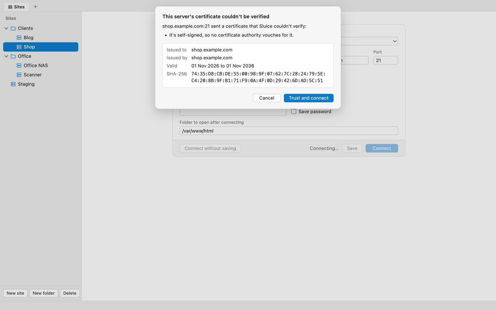
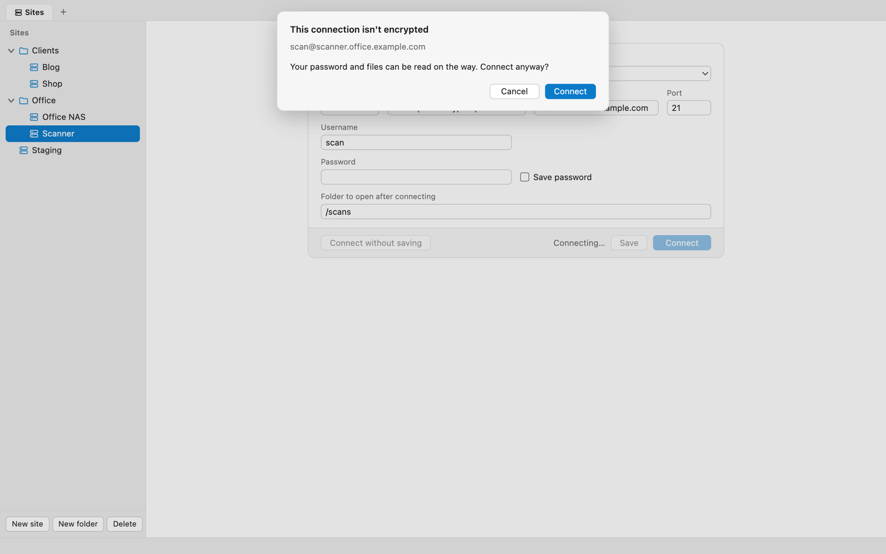

# Security and privacy

[User guide](README.md) › Security and privacy

## Server identity checks (SFTP and SCP)

Every SSH server has a key that proves who it is. Sluice checks it on every connection, so you know you're talking to your server and not to someone in between.

### The first time

The first time you connect to a server, Sluice asks **Trust this server?** It shows the key's type and its fingerprint, such as `SHA256:…`, and asks you to check that the fingerprint matches the one your server shows. **Trust and connect** is the default.

To see the fingerprint on the server, you can run a command such as this one there, for the key type Sluice showed:

```
ssh-keygen -lf /etc/ssh/ssh_host_ed25519_key.pub
```

Sluice remembers the keys you trust, and checks the key on every connection after that.

### If the key changes

If a server's key ever changes, Sluice says **This server's identity has changed**, and shows the key it saved and the key the server sent now. This can happen after a server is reinstalled, but it can also mean someone is intercepting the connection.

Here **Cancel** is the default, and Return always cancels. To trust the new key, you have to click **Trust the new key**. Do that only if you know why the key changed. If you cancel, Sluice says "Connection cancelled because the server's identity wasn't trusted."

### Keys you already trust

By default, keys you already trust in `~/.ssh/known_hosts` count too, so a server you've already connected to with `ssh`, at the same address, doesn't ask again. To count only the keys you've trusted in Sluice, turn off **Also trust hosts in ~/.ssh/known_hosts** in Settings › Connections.

## FTPS certificates

FTPS sites, with **TLS, explicit** or **TLS, implicit**, are encrypted, and the server proves who it is with a certificate.

- A certificate your computer already trusts is accepted without a question.
- With explicit TLS, Sluice requires the encryption. If the server won't encrypt the connection, Sluice doesn't connect. It never quietly drops to plain FTP.

### When a certificate can't be verified

When a certificate can't be verified, Sluice says **This server's certificate couldn't be verified**, and why. For example:

- It's self-signed, so no certificate authority vouches for it.
- Its issuer isn't a certificate authority that Sluice or your system trusts.
- It was issued for another name.
- It has expired, or isn't valid yet.

It also shows who the certificate was issued to and by, the dates it's valid, and its SHA-256 fingerprint, so you can check it. Then choose **Trust and connect**, or **Cancel**.



Sluice remembers a certificate you trust for that server and port. If the server later sends a different certificate that can't be verified either, Sluice says **This server's certificate has changed**, and shows the fingerprints of the old certificate and the new one. As with a changed host key, **Cancel** is the default, Return always cancels, and trusting the new one takes a click on **Trust the new certificate**.

## Plain FTP

A site with **None (not encrypted)** sends your password and files unencrypted, so anyone on the network between you and the server can read them. Use it only for servers that offer nothing else, on a network you trust.

Before such a site sends anything, Sluice asks:

> **This connection isn't encrypted**
>
> Your password and files can be read on the way. Connect anyway?



For a saved site, Sluice asks the first time it connects, and asks again if you change the site's host or port. With **Connect without saving**, it asks every time.

While you're connected, the status bar shows an open lock and "FTP (not encrypted)".

## Allow older encryption

Some older servers and devices offer only older encryption: older SSH methods for SFTP and SCP, or TLS 1.0 and 1.1 for FTPS. Sluice doesn't use these unless you turn on **Allow older encryption** in that site's settings.

These older methods are weaker, so turn it on only for a site that needs it. It's set for each site, so your other sites aren't affected. A few of the very oldest methods can't be used at all. When a server offers only those, Sluice says "This server only offers encryption that's too old for Sluice to use."

## Saved passwords

- Saved passwords and key passphrases are encrypted with your computer's keychain, and stored only on your computer.
- Sluice saves a password only when **Save password** is ticked. Untick it, and Sluice asks for the password each time you connect.
- For a key file, Sluice saves the file's path, not the key itself.
- Deleting a site deletes its saved password too.
- Sluice never shows a saved password again. In the site's form, the empty password field says "Unchanged".

## Copies of the files you edit

When you edit a file, Sluice keeps a private copy of it on your computer, which only your user account can read. When you stop editing, and nothing is left to upload, Sluice removes the copy. If you keep the server's version after a change on the server, your version goes to the Trash, not away for good.

## What Sluice sends over the internet

- Sluice connects only to the servers you add to it.
- To tell you about new versions, it asks GitHub for the latest release when it starts and once a day after that. It requests `https://api.github.com/repos/getsluice/sluice-releases/releases/latest` with the header `User-Agent: Sluice/<version>`. To stop it, turn off **Tell me when a new version is available** in Settings › General.
- It sends no analytics, crash reports or usage data.
- Your saved sites, settings and the copies of files you're editing stay on your computer.
- If you open files in another app, such as VS Code, that app's own privacy terms apply to it.

The [privacy policy](../PRIVACY.md) has the details, for the app and for the website.
