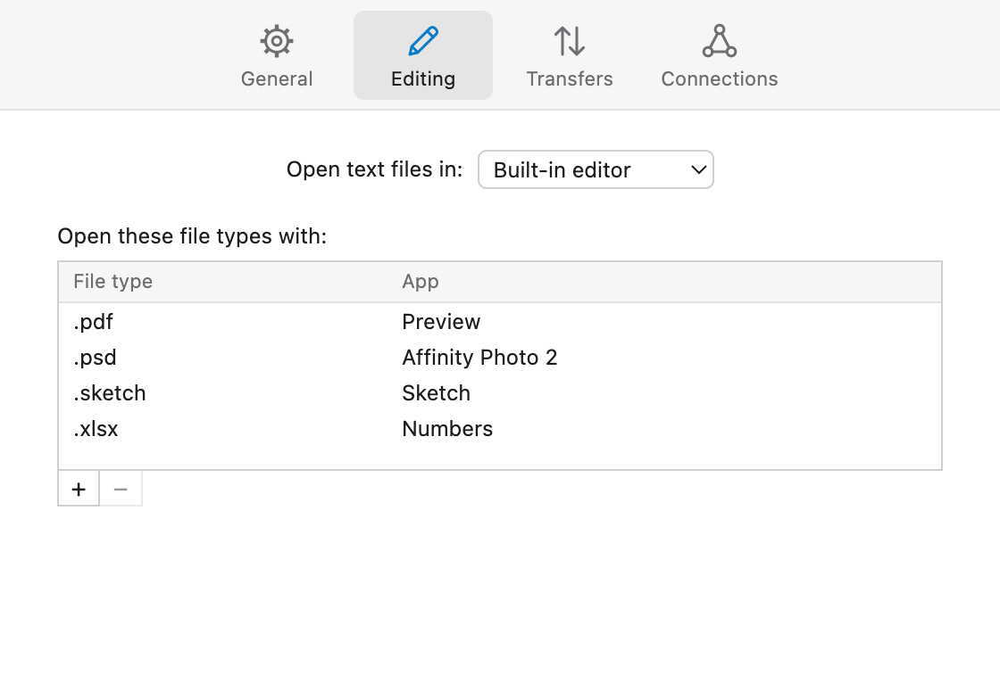

# Settings

[User guide](README.md) › Settings

Open Settings with ⌘, (Sluice › Settings…). It has four panes: **General**, **Editing**, **Transfers** and **Connections**. With one of their buttons in focus, ← and → move between them. Every change applies at once; there's no Save button.

## General

| Setting | What it does | Default |
| --- | --- | --- |
| Appearance | **Light**, **Dark**, or **Match Mac**, which follows your computer's appearance. | Light |
| Show hidden files | Shows files and folders whose names start with a dot, in every tab and in the folder tree. ⇧⌘. does the same. | Off |
| Tell me when a new version is available | Checks GitHub for a new version when Sluice starts and once a day after that. Turn it off to stop the check. | On |

## Editing

| Setting | What it does | Default |
| --- | --- | --- |
| Open text files in | **Built-in editor**, **Default text editor**, **VS Code**, or an app you choose with **Other App…**. | Built-in editor |
| Open these file types with | A table of file endings, such as `.png`, and the app that opens each. Use **+** and **−** to add and remove them. It applies whatever the setting above says. | Empty |

A file type is a dot, then up to 32 of a–z, 0–9, _, - and +. [Editing files](editing.md#which-app-opens-it) explains how Sluice picks the app.

## Transfers

| Setting | What it does | Default |
| --- | --- | --- |
| Transfers at the same time | How many uploads and downloads run at once, from 1 to 10. Saves from your editor always go first. | 3 |
| When a file already exists | **Ask**, **Overwrite**, **Skip**, **Rename** or **Only if newer**. | Ask |
| Download into | **The last folder used**, or a folder you pick with **Choose…**. | The last folder used |

The first time you download, **The last folder used** starts in your Downloads folder.

## Connections

| Setting | What it does | Default |
| --- | --- | --- |
| Send keepalives every … seconds | How often Sluice checks that a connection is still there, from 5 to 300 seconds. Three missed replies count as a drop. Untick it to turn keepalives off. | On, 15 seconds |
| If a connection drops, try to reconnect … times | How many times Sluice tries to reconnect by itself, from 0 to 10. | 5 |
| Also trust hosts in ~/.ssh/known_hosts | Counts the server keys you already trust in your SSH `known_hosts` file, as well as those you've trusted in Sluice. | On |

Connection settings count from the next connection, or the next check of a server's key.

## Settings for each site

Some settings belong to a site rather than to Sluice: the protocol, the encryption, the server path for WebDAV, **Allow older encryption**, how you log in, and the folder to open. They're in the site's form on the Sites tab. See [Sites](sites.md).
