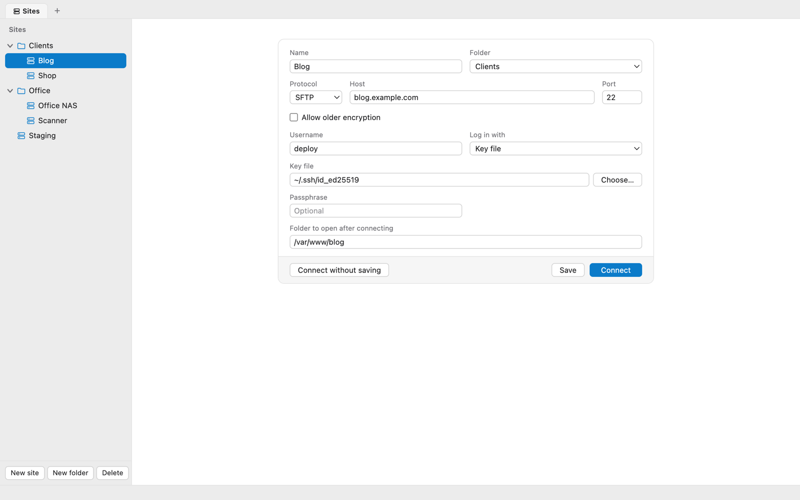
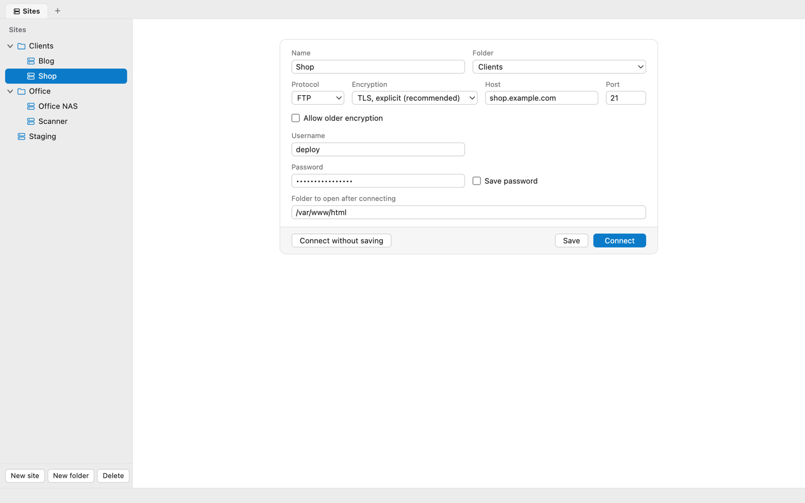

# Sites

[User guide](README.md) › Sites

A site is a server you've saved: its address, how to log in, and the folder to open. Your sites are on the **Sites** tab. To show it, choose **＋** in the tab strip, **Sites…** on the toolbar, or press ⌘T.

## The Sites tab

The left side lists your saved sites, folders first, then the sites that aren't in a folder, each in name order. Below the list are three buttons: **New site**, **New folder** and **Delete**.

- Click a site to show its settings on the right.
- Double-click a site, or select it and press Return, to connect.
- Hover over a site to see its `user@host`.

The right side is the selected site's form. Change anything in it, then choose **Save**, or **Connect** to save and connect in one go.

## The form, field by field

### Name

What the site is called in the list and on its tab. If you leave it empty, Sluice names it `user@host`.

### Folder

The folder of sites this site is in, or **None** to keep it at the top of the list. See [Folders of sites](#folders-of-sites).

### Protocol

How Sluice talks to the server.

- **SFTP** is the default, and the right choice for most servers you reach over SSH.
- **SCP** is for servers without SFTP, such as some routers, NAS boxes and locked-down hosting. The form says "For servers without SFTP." under it.
- **FTP** is for servers you reach over FTP or FTPS. Choosing it adds the **Encryption** menu and takes away **Log in with**, because FTP logs in with a password only.

You don't always need to choose SCP yourself. If an SFTP site's server turns out to have no SFTP, Sluice carries on over SCP on the same connection, so you don't log in a second time. The status bar then says "SCP (no SFTP here)", and the site stays an SFTP site.

### Encryption (FTP only)

- **TLS, explicit (recommended)** is the default. The connection starts on the FTP port and is then encrypted. Sluice requires the encryption: if the server won't encrypt the connection, Sluice doesn't connect, and it never quietly drops to plain FTP.
- **TLS, implicit** is for servers that encrypt from the very start. Its usual port is 990.
- **None (not encrypted)** is plain FTP, for servers that offer nothing else. Your password and files can be read on the way, so Sluice asks before it connects. See [Security and privacy](security-and-privacy.md#plain-ftp).

### Host

The server's address, such as `example.com` or an IP address.

### Port

The port the server listens on. Sluice fills in the usual one: 22 for SFTP and SCP, 21 for FTP with explicit TLS or no encryption, and 990 for FTP with implicit TLS. When you change the protocol or the encryption, the port moves to the new usual one, unless you've typed a port of your own, which Sluice keeps.

### Allow older encryption

Lets Sluice use older methods that some older servers and devices still need: older SSH methods for SFTP and SCP sites, and TLS 1.0 and 1.1 for FTPS sites. It's set for each site, so your other sites aren't affected. Leave it off unless a server needs it. If it does, Sluice tells you: "This server only offers older encryption. To connect, turn on Allow older encryption in this site's settings."

FTP sites with **None (not encrypted)** don't show this box, because there's no encryption to allow.

### Username

The name you log in with.

### Log in with (SFTP and SCP)

- **Password**: type it in **Password**. Leave **Save password** ticked to have Sluice remember it, encrypted with your computer's keychain. Untick it to have Sluice ask for the password each time you connect. When a password is saved, the empty field says "Unchanged": type a new one only to replace it.
- **Key file**: a private key on your computer. Type its path in **Key file**, or choose **Choose…** to pick it. Sluice reads OpenSSH, PEM and PuTTY `.ppk` keys. If the key has a passphrase, type it in **Passphrase** to save it, or leave that empty and Sluice asks for it when you connect.
- **SSH agent**: Sluice asks your SSH agent for keys and tries each one in turn. By default it uses the agent named by `SSH_AUTH_SOCK`. To use another agent, type the path to its socket in **Agent socket**.
- **One-time code**: for servers that ask questions as you log in, such as a code from an app. The form says "The server's questions, such as a one-time code, are asked when you connect." Sluice shows each question the server sends, and sends back your answers. If the server asks for a password instead, Sluice asks you for one.

With a password, if the server asks for a one-time code after the password, Sluice shows that question too.

Sluice gives you three tries at a password or passphrase before it stops.

### Password (FTP)

FTP sites always log in with a password. **Save password** works as it does for SFTP. Key files and SSH agents are for SFTP and SCP sites only.

### Folder to open after connecting

The folder Sluice shows when it connects, as a full path starting with `/`, such as `/var/www`. Leave it empty to open your home folder on the server.

## Save, Connect and Connect without saving

- **Save** saves the site and says "Saved".
- **Connect** saves the site, then connects in this tab. Return does the same. If **Save password** is unticked, a password you've typed is used for this connection but not saved.
- **Connect without saving** connects with what you've typed, and saves nothing. The site isn't added to the list, and the password is used whether or not **Save password** is ticked. If the form has no name, the tab is called `user@host`.

If a field needs fixing, Sluice marks it and says why:

| Field | Message |
| --- | --- |
| Host | Enter the server address |
| Port | Port must be a number from 1 to 65535 |
| Username | Enter a username |
| Key file | Choose a key file |
| Key file, Agent socket | Use a full path starting with / or ~/ |
| Folder to open after connecting | Use a full path starting with / |

If the connection fails, the reason shows at the bottom of the form, and everything you typed stays. [Troubleshooting](troubleshooting.md) lists the messages.

## Folders of sites

Folders keep the list tidy. They hold sites, one level deep.

- **New folder** adds a folder. Type its name and press Return, or press Escape to cancel.
- To rename a folder, double-click its name, or select it and press F2.
- To open or close a folder, click its arrow, double-click it, or use → and ←.
- To move a site into a folder, drag it onto the folder, or choose the folder in the site's **Folder** menu and save. To take it out, drag it onto the empty space below the list, or choose **None**.

**New site** starts the new site in the selected folder, or in the folder of the selected site.

## Delete a site or a folder

Select it and choose **Delete**, or press ⌘⌫. Sluice asks first, with **Cancel** as the default.

- Deleting a site deletes its saved password too.
- Deleting a folder moves its sites to the top level. No site is deleted.

## Keyboard in the list

| Key | What it does |
| --- | --- |
| ↑ and ↓ | Select the site or folder above or below. |
| → and ← | Open or close a folder; ← on a site in a folder selects the folder. |
| Return | Connect to the selected site, or open or close the selected folder. |
| F2 | Rename the selected folder. |
| ⌘⌫ | Delete the selected site or folder. |
