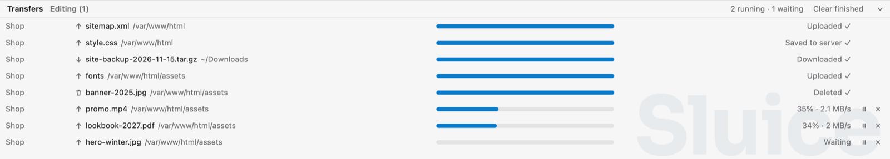

# Transfers

[User guide](README.md) › Transfers

## Upload

Uploads go into the folder the file list shows.

- Drag files or folders from Finder onto the file list.
- Or choose **Upload** on the toolbar, File › Upload…, or **Upload…** in the right-click menu. A panel opens for you to choose files or folders. Pick them and choose **Upload**.

## Download

Select the files and folders to download, then choose **Download** on the toolbar, File › Download…, or **Download…** in the right-click menu. A panel opens for you to choose the folder to download into.

The folder it suggests is set in Settings › Transfers › **Download into**: **The last folder used**, which is your Downloads folder the first time, or a folder you choose.

## Folders and links

Folders go with everything in them.

Links are handled carefully. When you upload, a link to a file is copied as the file it points to. A link to a folder, a link to nothing, and a link that loops back on itself are skipped, and the transfer's row says how many, such as "2 links skipped". Downloads follow the same rules.

## When a file is already there

What happens when a file with the same name is already there is set in Settings › Transfers › **When a file already exists**. The default is **Ask**. Sluice then asks, showing the size and date of the existing file and of the new one:

- **Skip**, the default, leaves the existing file as it is.
- **Overwrite** replaces it.
- **Rename** gives the new file a free name, such as `report (2).txt`.
- **Only if newer** replaces it only if the new file was modified later.
- **Cancel** stops the transfer.

Tick **Apply to all** to give the same answer for the rest of that upload or download.

## The transfer panel

Transfers show in the **Transfers** tab of the bottom panel. Each row shows the server, the file's name (hover over it for its full path), a progress bar and a status, such as:

| Status | What it means |
| --- | --- |
| Waiting | In line for a free slot. |
| Counting files… | Sluice is finding out how much a folder holds. |
| 62% · 1.4 MB/s | Under way. |
| Paused | You paused it. |
| Waiting for connection | The connection dropped, and Sluice is reconnecting. |
| Waiting for connection · tries again when you next use this site | Sluice stopped reconnecting. The transfer goes on the next time you use the site. |
| Uploaded ✓, Downloaded ✓, Saved to server ✓, Deleted ✓ | Done. |
| Failed · (the reason) | It couldn't finish. |
| Cancelled | You cancelled it. |

Above the rows, a summary says what's going on, such as "2 running · 1 waiting". **Clear finished** removes the rows that are done or cancelled. Failed rows stay, so you can retry them.

To make the panel taller or shorter, drag its top edge. To hide it, choose the arrow at its right. While it's hidden, **Show transfers** in the status bar brings it back, with the summary and the overall progress.

### How many at once

Sluice runs up to three uploads and downloads at the same time. Change it in Settings › Transfers › **Transfers at the same time**, from 1 to 10. Saves from your editor always go first, ahead of everything else waiting, so a big transfer never holds up a save.

## Pause, Resume, Retry and Cancel

Each row has the buttons that fit its state.

- **Pause** stops an upload or download that's running or waiting. Saves and deletes can't be paused.
- **Resume** starts a paused transfer again. Over SFTP, and over FTP where the server supports it, a file continues from where it stopped. Over SCP, a file starts again from the beginning. A folder continues from the file it had got to.
- **Retry** tries a failed transfer again, or one waiting for its connection, at once.
- **Cancel** stops any transfer that hasn't finished.

## Safe uploads

Where the server allows it, Sluice uploads each file to a temporary file in the same folder, then renames it into place in one step. That way the file on the server is never left half written.

## When the connection drops

Sluice keeps an eye on each connection. If one drops, it reconnects by itself, while the status bar says **Reconnecting…**.

- It tries five times by default, waiting 1, 2, 4, 8 and then 16 seconds before each try. Change the number in Settings › Connections › **If a connection drops, try to reconnect … times**, from 0 to 10. Tries after the fifth wait 30 seconds each.
- It sends a keepalive every 15 seconds by default, and counts three missed replies as a drop. Change it in Settings › Connections › **Send keepalives every … seconds**, from 5 to 300, or untick it to turn keepalives off.
- When your computer wakes from sleep, or its network changes, Sluice checks each connection, and reconnects the ones that don't answer.

Uploads, downloads and saves that were under way wait while Sluice reconnects, then carry on by themselves.

If Sluice runs out of tries, the status bar says **Disconnected**. The next thing you do on that site, such as opening a folder or choosing Refresh, connects again, and waiting transfers go on then. You can also choose **Retry** on a transfer at any time.

A rename, a new folder, a new file or a permissions change that was cut off by a drop is never sent a second time. Sluice says the connection dropped, lists the folder again, and asks you to check whether the change was made.

## Quitting with transfers under way

If you quit while uploads or downloads haven't finished, Sluice warns that they'll stop, with **Quit anyway** and **Cancel**. **Cancel** is the default.
